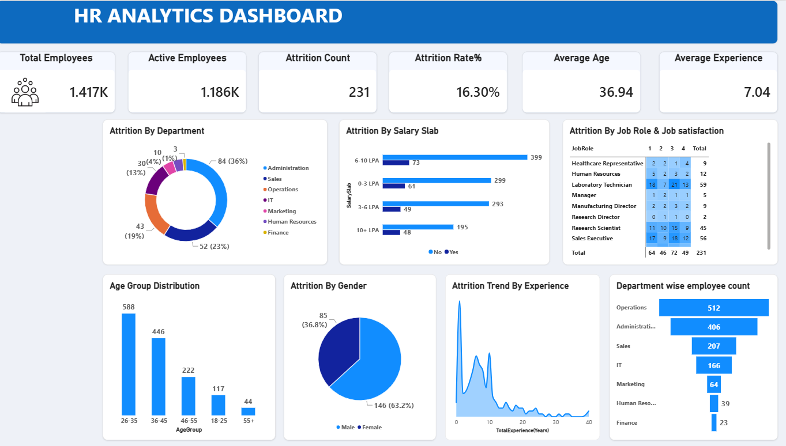

# 👥 HR Analytics Dashboard (Power BI)

An interactive Power BI dashboard analysing employee attrition across departments, salary slabs, job roles, job satisfaction, age groups, gender and experience, to understand who leaves and why.

## 🎯 Objective
To identify the groups with the highest attrition so that HR can focus retention efforts where they matter most.

## 🗂️ Dataset
- **Name:** [HR Analytics]
- **Size:** 1,417 employees × 38 columns
- **Key fields:** department, job role, salary slab (LPA), job satisfaction, age, gender, total experience, attrition status

## 🛠️ Tools Used
Power BI (data modelling, DAX measures, interactive visuals)

## 📊 Dashboard Features
- KPI cards: total employees, active employees, attrition count, attrition rate, average age, average experience
- Attrition by department
- Attrition by salary slab
- Attrition by job role and job satisfaction (matrix)
- Age group distribution
- Attrition by gender
- Attrition trend by experience
- Department-wise employee count

## 📈 Key Insights

**Overall**
- Of **1,417 employees**, **231 left**, an **attrition rate of 16.30%**, leaving **1,186 active employees**.
- The average employee is **36.9 years old** with **7.0 years of experience**.

**Departments** *(attrition rate calculated as leavers ÷ department headcount)*
- **Administration** lost the most people (**84, 36% of all leavers**), and **Sales** was second (**52, 23%**).
- Relative to size, **Sales has the highest attrition rate at about 25%** (52 of 207), followed by **Administration at about 21%** (84 of 406) and **IT at about 18%** (30 of 166).
- **Operations is the largest department (512 employees) but has the lowest attrition rate, about 8%** (43 leavers).

**Salary**
- The highest attrition rate is in the **10+ LPA slab at about 20%** (48 of 243), above the company average. Higher pay alone doesn't guarantee retention.
- The **6-10 LPA slab has the most leavers (73)**, but because it's also the largest group, its rate is about 15%, below average.

**Job roles and satisfaction**
- **Laboratory Technicians (59)**, **Sales Executives (56)** and **Research Scientists (45)** account for the largest number of leavers.
- Satisfaction alone doesn't explain attrition: **121 of 231 leavers (52%) gave a satisfaction rating of 3 or 4**, while 64 leavers gave a rating of 1.

**Demographics and experience**
- **Male employees make up 63.2% of leavers (146)** and female employees 36.8% (85).
- **26-35 is the biggest age group (588 employees, about 41% of the workforce)**, and 73% of employees are between 26 and 45.
- The attrition-by-experience trend shows the highest exits among **employees with the least experience**, with smaller peaks around the 5-8 and 10-year marks and very few exits after 20 years.

## 💡 Recommendations
- Focus retention efforts on **Sales and Administration**, where attrition rates are highest.
- Review pay, growth paths and workload for the **10+ LPA** group, which leaves at an above-average rate.
- Strengthen **onboarding and early-career support**, since the earliest years of experience see the most exits.
- Look beyond satisfaction scores, because most leavers reported a rating of 3 or 4. Exit interviews and engagement surveys could uncover other reasons.

## 🖼️ Dashboard Preview


## 📁 Repository Structure
```
hr-analytics-powerbi/
├── data/       # Dataset
├── images/     # Dashboard screenshot
├── powerbi/    # Power BI file (.pbix)
└── README.md
```

## ▶️ How to Open
Download the `.pbix` file from the `powerbi` folder and open it with **Power BI Desktop** (free from Microsoft).

## 👤 Author
**Sidharth R**
[LinkedIn](https://www.linkedin.com/in/sidharth-r-943115233) · [GitHub](https://github.com/sidharthram99) · ✉️ sidharthram99@gmail.com
